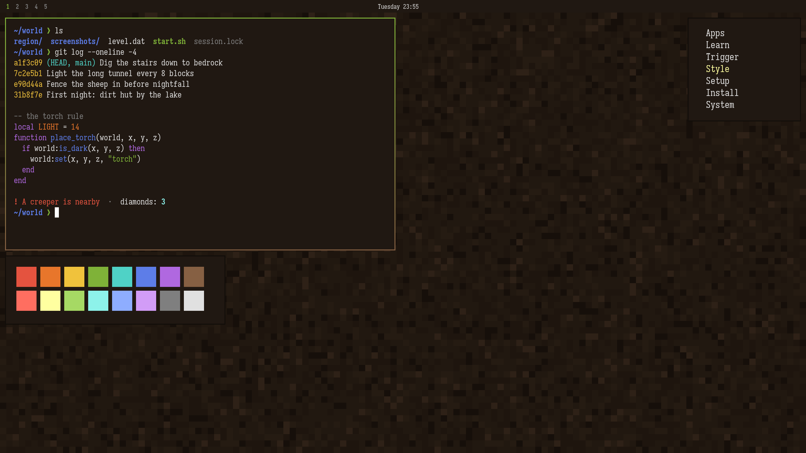
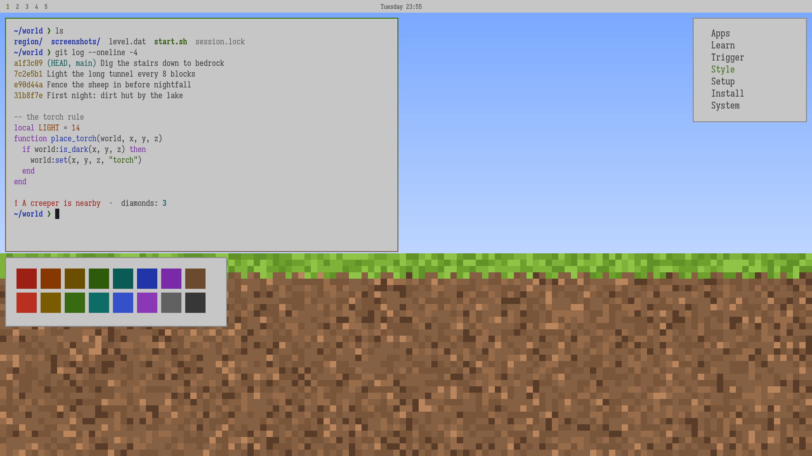

# Cave Game

Two [Omarchy](https://omarchy.org) themes based on Minecraft as it was in
Alpha and Beta, before the big updates: blocky clouds, a torch by the lake, a
dirt hut at sunset. "Cave Game" was the game's first working title.

**Cave Game** is the night and underground half. The background is the
darkened dirt from behind the old Select World and Options screens. The text
is the grey-white of the old menu buttons, and the accent is grass green.



**Cave Game Day** is the daytime half. It uses the grey of the inventory
screen, with dark-grey labels.



## Install

```bash
git clone https://github.com/Dielerorn/omarchy-cave-game.git
cd omarchy-cave-game
./install.sh
```

The installer copies both themes into `~/.config/omarchy/themes`, downloads
the 13 wallpapers, crops them to fit, and applies **Cave Game**. Then switch
whenever you like:

```bash
omarchy theme set "Cave Game"
omarchy theme set "Cave Game Day"
omarchy theme bg next          # next wallpaper
```

Options: `--no-wallpapers` skips the download, and `--theme cave-game-day`
(or `none`) changes what gets applied at the end. Reinstalling backs up the
old copies to `~/.local/state/omarchy-cave-game/` first. Nothing under
`/usr/share/omarchy` is touched.

The wallpaper step needs `curl` and ImageMagick (`magick`), which Omarchy
already ships.

## Palette

Every colour is a block or a piece of the old interface.

| token | Cave Game | Cave Game Day | from |
|---|---|---|---|
| `background` | `#201812` | `#C6C6C6` | dirt behind the old menus / the inventory screen |
| `foreground` | `#E0E0E0` | `#373737` | a menu button's label / the GUI's shadow line |
| `accent` | `#7FB238` | `#3F6E15` | the green on top of a grass block |
| `red` | `#E4533F` | `#9E1F14` | TNT, redstone |
| `orange` | `#E8762B` | `#873800` | lava |
| `yellow` | `#F0C23C` | `#6B4E00` | gold |
| `green` | `#7FB238` | `#2D5A0B` | grass, leaves |
| `cyan` | `#4FD2C6` | `#0A5A55` | diamond |
| `blue` | `#5D7DE8` | `#1F35A8` | water |
| `magenta` | `#B068E0` | `#7A2AA6` | the Nether portal |
| `brown` | `#866043` | `#6B4A2E` | dirt, oak log |

In Cave Game Day, every terminal colour is darkened so it stays readable on
the grey: at least 4.5:1 contrast for normal colours and 3.5:1 for bright ones.

## Small touches

- **Window border:** like the side of a grass block, green at the top fading
  to dirt at the bottom.
- **Tooltips:** the in-game item tooltip, a near-black card with a purple edge
  and white text, in both halves.
- **Menu and launcher:** in Cave Game, the highlighted row turns the same pale
  yellow (`#FFFFA0`) that a button's label did under the mouse.
- **Icons:** Yaru-olive.

## Wallpapers

The wallpapers are uploads on [wallhaven.cc](https://wallhaven.cc), mostly
fan screenshots of the game. They belong to their uploaders and to Mojang, so
they are not in this repo. `fetch-wallpapers.sh` downloads each one, checks it
against a recorded SHA-256 and cuts it to 3440×1440. If an upload disappears
or changes, that image is skipped and the rest still install. The full list
with links is in [CREDITS.md](themes/cave-game/CREDITS.md).

| Cave Game | Cave Game Day |
|---|---|
| cave with torches and lava | village with sheep |
| sunset under blocky clouds | lake and hill |
| torch by a lake at night | grass hills |
| dusk | grass block |
| creeper in the dark | creeper face |
| moonrise | snowy taiga |
| diamond ore | |

The preview images above don't use any of them. Their backgrounds are drawn
by `themes/cave-game/forge/backdrop.py`.

## Uninstall

```bash
omarchy theme set "Tokyo Night"      # or any other theme
rm -rf ~/.config/omarchy/themes/cave-game ~/.config/omarchy/themes/cave-game-day
rm -rf ~/.cache/omarchy-cave-game
```

## License

The palettes, scripts and generated previews are MIT-licensed. The wallpapers
are not covered by that license; see above.

Minecraft is a trademark of Mojang Synergies AB. This is an unofficial fan
theme, not affiliated with or endorsed by Mojang or Microsoft.
